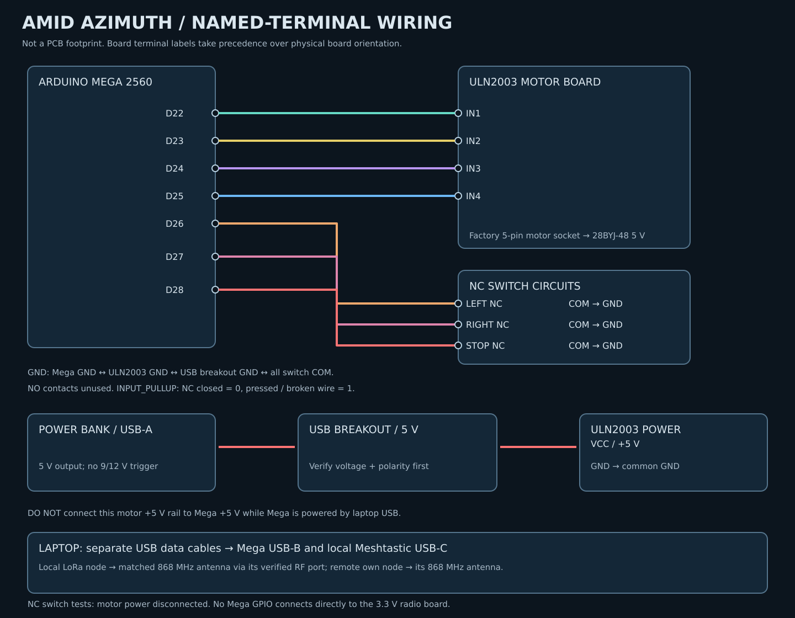

# AMID Azimuth · open-source antenna pointing bench

**v0.5.0 · experimental hardware, physical tests pending.**
Arduino Mega drives a lightweight horizontal stage; a laptop connects it to two
own Meshtastic LoRa EU868 nodes. A local browser panel controls the bench.
This does not provide global coverage or general Internet over LoRa.

**Українською:** [Повна інструкція](README_UA.md) ·
[Складання та перший пуск](FIRST_RUN_UA.md) · [Панель керування](PANEL_UA.md).



| Start here | Contents |
|---|---|
| [FIRST_RUN_UA.md](FIRST_RUN_UA.md) | Parts, NC checks, power, motor, homing, radio and first scan |
| [PIN_TO_PIN.csv](PIN_TO_PIN.csv) · [BOM.csv](BOM.csv) | Named terminal mapping and bill of materials |
| [PANEL_UA.md](PANEL_UA.md) | Local browser panel, commands, watchdogs and shutdown |
| [TROUBLESHOOTING_UA.md](TROUBLESHOOTING_UA.md) | Symptoms, causes and next checks |
| [PROTOCOL.md](PROTOCOL.md) | Mega serial protocol and future app integration |
| [VALIDATION.md](VALIDATION.md) | Software evidence and hardware checks still NOT_RUN |
| [BENCH_CHECKLIST.csv](BENCH_CHECKLIST.csv) | Blank physical acceptance record |
| [CONTRIBUTING.md](CONTRIBUTING.md) | Reproduce tests and contribute |

## Quick start / Windows

Download and extract this repository (Code → Download ZIP), then open
`hardware/azimuth`. Flash `firmware/AMID_Azimuth/AMID_Azimuth.ino` using Arduino IDE,
Mega 2560 / ATmega2560. Run `SETUP_WINDOWS.cmd`, then `START_WINDOWS.cmd`.
Select 1 for NC diagnostics with motor power disconnected; read FIRST_RUN_UA.md
before using movement commands. Select 4/5 for browser motor/radio panels.
All ports and peer IDs in the examples are placeholders, not detected devices.

Motor reference: **5 V 28BYJ-48 + ULN2003**, independent bearing carrying the load,
three normally closed switch circuits. The motor is not suitable for an arbitrary
heavy antenna or wind load without redesign and physical tests. Firmware remains
v0.3 / INFO 2; desktop package version is v0.5.0. Existing v0.3 firmware works.

## Reproduce

Python 3.12 is used for CI. Runtime supports Python 3.10+; firmware download/build
scripts require Python 3.12 on Linux x86-64. See CONTRIBUTING.md.

```sh
python -m pip install -r requirements.txt
python -m unittest discover -s tests -p 'test_*.py' -v
g++ -std=c++11 -Wall -Wextra -Werror -I tests tests/test_firmware.cpp -o test_firmware
./test_firmware
```

Own source and documentation: [MIT](LICENSE).
Arduino core, compiler, Meshtastic and other dependencies retain their own
licenses; see [THIRD_PARTY_NOTICES.md](THIRD_PARTY_NOTICES.md).
The native AMID Offgrid app is a separate client; this stage currently uses USB
and a laptop, not direct BLE motor control from an iPhone.
