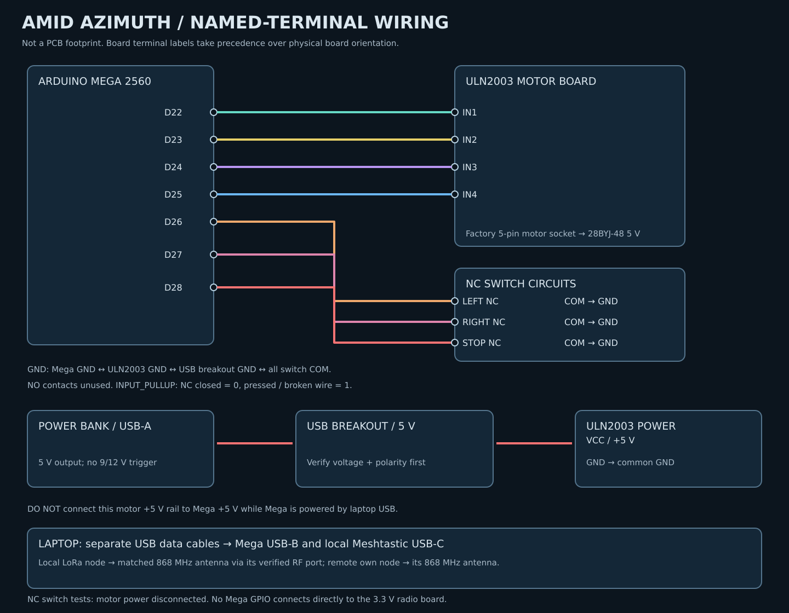

# AMID Azimuth 0.5.0 — відкритий стенд самонаведення

Цей модуль містить вихідний код, електричні з’єднання, інструкцію першого пуску й
перевірки горизонтального приводу для легкої спрямованої антени. **Фізичні тести
мотора, конкретного павербанка, радіо/ACK та дальності ще NOT_RUN.**

Мета першого стенда — перевірити принцип вибору напрямку за відповідями
другого власного LoRa-вузла. Антена не замінює радіомодуль; LoRa не забезпечує
звичайний інтернет або гарантоване покриття в будь-якій точці світу.

## Що потрібно

| Частина | Референсний варіант |
|---|---|
| Контролер | Arduino Mega 2560 |
| Привід | 28BYJ-48 саме 5 V + ULN2003 |
| Механіка | Легка платформа, окремий підшипник, муфта, запас коаксіалу |
| Кінцевики | Два COM/NC + окрема NC стоп-кнопка |
| Живлення приводу | Готовий захищений павербанк, перевірений вихід USB 5 V та breakout |
| Зв’язок із ПК | USB data для Mega та локального радіовузла |
| Радіо | Два власні сумісні Meshtastic SX1262 / EU868-вузли, наприклад відповідні T3-S3 |
| Антени | Штатні 868 MHz для початкових пакетів; узгоджена спрямована 868 MHz для пошуку |
| ПК | Ноутбук, Python 3.10+, Arduino IDE; для збірки CI — Linux/Python 3.12 |

[BOM.csv](BOM.csv) — повний список. Конкретну ревізію радіоплати, її активний
RF-вихід, роз’єм та пігтейл треба звірити до покупки. Не переносити креслення
5 GHz Wi-Fi-«пушки» на 868 MHz без нового RF-проєктування та вимірювань.

## Порядок від нуля до першого пошуку

1. Відкрий [FIRST_RUN_UA.md](FIRST_RUN_UA.md). Перевір комплект і контакти мультиметром.
2. З’єднай [pin-to-pin](PIN_TO_PIN.csv), орієнтуючись на підписи контактів, а не схожість плат.
3. Проший `firmware/AMID_Azimuth/AMID_Azimuth.ino`: Mega 2560 / ATmega2560.
4. Виконай SETUP_WINDOWS.cmd, потім START_WINDOWS.cmd → 1. Моторне живлення від’єднане; натисни й відпусти кожен NC-перемикач та звір відповідний вхід.
5. Перевір 5 V і полярність. Під’єднай моторне живлення та спільну GND; не об’єднуй його позитивну лінію з +5 V USB-живленої Mega.
6. Без антени перевір JOG ±16 і напрямок. Потім ARM → HOMED. Кінцевики спрацьовують до механічних упорів.
7. Перевір два радіовузли штатними антенами: режим 3 або 5 → PROBE → дійсний real_radio_ack. Якщо ACK немає — спочатку усунь причину.
8. Після моторної й радіоперевірки встанови легку спрямовану антену на власний підшипник. Перевір кабель у всьому секторі. ARM → HOMED → SCAN.
9. Переглянь sessions/.../report.html і CSV. Запиши фізичні результати в [BENCH_CHECKLIST.csv](BENCH_CHECKLIST.csv).
10. STOP → перевір події Mega → Ctrl+C → зніми моторне живлення.

## Як працює пошук

Після пошуку лівого кінцевика привід відступає всередину сектору. Положення
0..3072 номінальних кроків відповідає умовному сектору −135°..+135° за
STEPS_REV=4096. Реальний редуктор, люфт і пропуски кроків потребують калібрування.
Механічні кінцевики закладаються приблизно біля ±145°, до твердих упорів.
Безперервний поворот 360° не реалізований.

Прошивка перевіряє 10 грубих положень, потім 3 уточнювальні навколо найкращого.
Перед пакетом мотор стоїть 1.5 с. Вікно пошуку завершується не раніше 30 с із
щонайменше двома різними ACK або після 80 с очікування. Порівнюється медіана
RSSI; близькі значення розрізняються за SNR. Контроль знайденого положення —
80-секундними вікнами; дві невдалі перевірки запускають повторний пошук.
Немає сигналу — немає вигаданого напрямку чи нульових «вимірювань».

Міст надсилає короткі приватні запити другому власному вузлу не частіше ніж раз
на 30 с, hopLimit=0, wantAck=true. Відкидає інший peer/requestId, MQTT, ознаки
ретрансляції, повтори та відповіді попереднього положення. Метадані довірені
прошивці, а не незалежно доведеному RF-маршруту. Автоматичний ACK PRIVATE_APP
і конкретні плати ще треба перевірити фізично. Штатні обмеження ефіру не вимикаються.

## Керування і зупинка

[Панель](PANEL_UA.md): локальний браузер на тому самому ноутбуці. Меню 4 — мотор,
5 — радіо + мотор, 6 — вихід. Підключення не запускає рух. ARM, SCAN та JOG є
явними командами руху. PROBE і SCAN недоступні в motor-режимі.

У Mega є heartbeat-таймер, NC-входи й програмні межі. Панель додатково контролює
heartbeat сторінки, а міст — heartbeat панелі. Втрата зв’язку запитує STOP;
повернення сторінки не відновлює рух. Після 5 хвилин READY/NO_SIGNAL котушки
вимикаються; наступний рух потребує ARM. Активне утримування може нагрівати мотор.
Стоп-кнопка — програмний NC-вхід, силове зняття моторного живлення виконується
від’єднанням його USB від павербанка.

## Файли, відтворення та межі

[PROTOCOL.md](PROTOCOL.md) — команди й телеметрія. Прошивка v0.3 використовує
INFO 2 та INPUTS 1; версія програми ноутбука — 0.5.0. Пряме керування цим
приводом із AMID на iPhone ще не реалізоване; нинішня схема потребує ноутбука.

[VALIDATION.md](VALIDATION.md) і [TEST_REPORT.json](TEST_REPORT.json) описують
докази програмних перевірок. [CONTRIBUTING.md](CONTRIBUTING.md) — повторення
тестів, Linux AVR-збірки та створення ZIP. Git-репозиторій містить вихідний код;
HEX/ELF генеруються збіркою. У binary ZIP також включається відповідний повний
архів вихідних матеріалів Arduino core. [Ліцензії](THIRD_PARTY_NOTICES.md).

[Пошук несправностей](TROUBLESHOOTING_UA.md). Не вважай стенд перевіреним аварійним
пристроєм до фізичного приймання; дальність і точні градуси не встановлені.

Офіційні джерела: [Arduino Mega](https://docs.arduino.cc/hardware/mega-2560/),
[ULN2003A](https://www.ti.com/product/ULN2003A),
[Meshtastic API](https://github.com/meshtastic/python),
[LoRa config](https://meshtastic.org/docs/configuration/radio/lora/).
