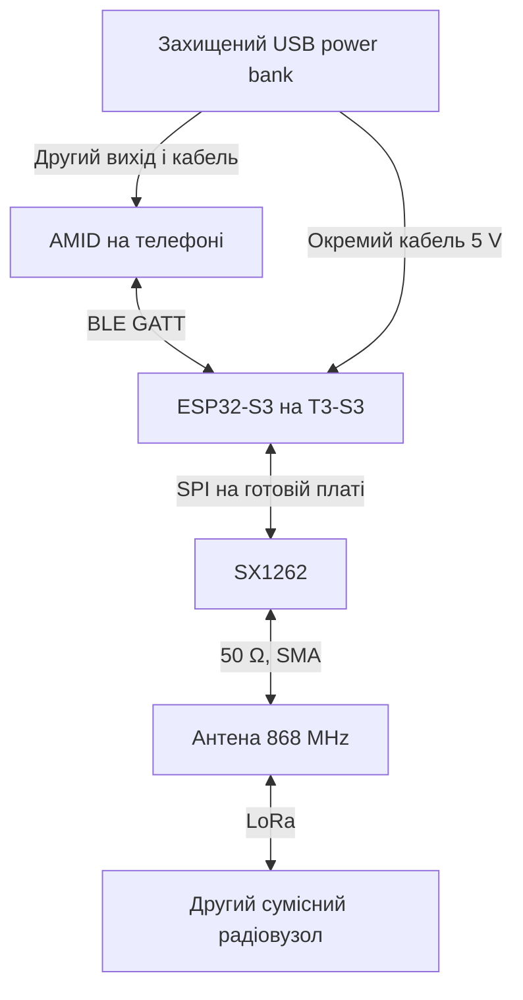
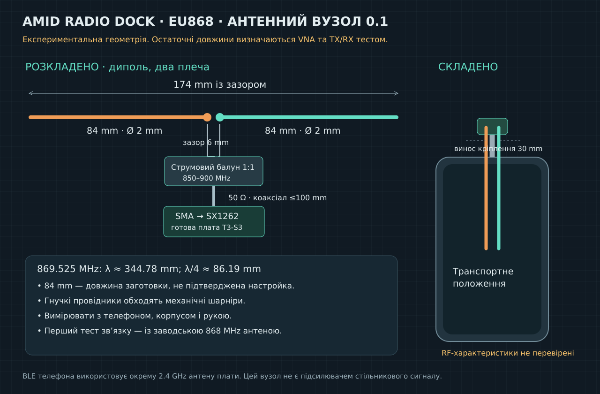

# AMID Radio Dock 0.1 — технічний прототип

Це знімний радіомодуль для телефона: Bluetooth з’єднує AMID із власною платою,
а SX1262 передає короткі повідомлення через LoRa. Прототип використовує готову
LILYGO T3-S3 V1.3 **SX1262 / 868 MHz** та офіційну Meshtastic 2.7.26.54e0d8d.
Інші радіочипи/частотні варіанти T3-S3 мають інші прошивки. Нову прошивку AMID
для радіо тут не вигадано: реалізований клієнт її відкритого BLE API.

Додаток: «Поруч із тобою» → «Радіочохол LoRa». Радіочохол має окремий адаптер;
попередній прямий Bluetooth-сеанс між телефонами збережено. Обидва режими
використовують Bluetooth по черзі. Глобальне покриття та інтернет через LoRa
цим прототипом не забезпечуються.

## З’єднання



На першому етапі не потрібно перепаювати RF-тракт або SPI: вони вже розведені
на T3-S3. Референсні з’єднання всередині плати: SCK GPIO5, MISO GPIO3, MOSI GPIO6,
NSS GPIO7, RESET GPIO8, DIO1 GPIO33, BUSY GPIO34. OLED: SDA18/SCL17; BOOT0; LED37.
Це карта з’єднань виробника, не інструкція замкнути ці сигнали між собою.

Живлення прототипу — готовий захищений power bank із двома виходами. Один
живить USB плати, другий заряджає телефон через гнучкий кабель. Закладається
5 V / 1 A для радіоплати та 5 V / 2 A для телефона одночасно; це запас джерела,
а не виміряне споживання. Немає паралельного з’єднання акумуляторів, саморобного
PD-контролера чи передачі силового навантаження через порт телефона. Автономність
визначається після вимірювання реального струму й корисної енергії power bank.
Для опційного Li-ion роз’єму плати виробник вимагає захищений акумулятор;
цей варіант не входить до першої схеми живлення.



## Антена: готова для першого зв’язку, власна для налагодження

Перший TX/RX тест виконують із заводською налаштованою 868 MHz антеною. Для
складного вузла можна застосувати сумісний RF-шарнір/SMA, перевіривши його втрати
та механічне навантаження. Це антена LoRa; Bluetooth використовує власну 2.4 GHz
антену плати. Вона не замінює стільникову антену телефона і не створює інтернет.

Власний експериментальний варіант — центрально живлений диполь із двома
складними плечима. Для референсу EU868 / LONG_FAST береться 869.525 MHz:

| Параметр | Референс |
| --- | --- |
| Довжина хвилі у вільному просторі | приблизно 344.78 mm |
| Чверть хвилі | приблизно 86.19 mm |
| Оцінка плеча з коефіцієнтом 0.95 | приблизно 81.88 mm |
| Початкова довжина заготовки плеча | 84 mm, два плеча |
| Проміжок біля живлення | 6 mm |
| Повний розмах заготовок | 174 mm |
| Товщина провідника | 2 mm |
| Підвід | 50 Ω, до 100 mm коаксіалу |
| Симетрування | струмовий балун 1:1, специфікований на 850–900 MHz |

Розрахунок λ=c/f визначає початковий масштаб. Коефіцієнт укорочення, балун,
ізоляція, шарніри, корпус, телефон і рука змінюють резонанс. **84 mm — заготовка,
не підтверджений остаточний розмір.** Електричне з’єднання плеча проходить коротким
гнучким провідником повз механічний шарнір. Плечі не контактують між собою або
з телефоном; балун і коаксіал фіксуються окремо. Металізоване покриття/графітове
наповнення біля RF-вузла не використовують до перевірки впливу.

VNA калібрується на площині живлення антени. Спочатку вимірюють S11 без телефона,
потім у зібраному чохлі з телефоном і в руці. Ціль прототипу — SWR ≤2 на реальному
каналі з прийнятною смугою, а також повторний TX/RX тест; низький SWR сам по собі
не доводить ефективність випромінювання. Підрізають плечі симетрично маленькими
кроками. Положення «складено» — транспортне: характеристики в ньому не перевірені.
Антену під’єднують до ввімкнення живлення й передавання. Галочка в AMID керує лише ручним
надсиланням; власні маяки Meshtastic налаштовуються на радіо окремо.

## Корпус і складання

`cad/phone_carrier.scad` — параметричний ескіз носія з боковими ручками, проходами
для ремінців і винесеним на 30 mm діелектричним кріпленням антени. Плата має
контур приблизно 27.25 × 64.59 mm за DXF виробника; SMA/USB і компоненти виходять
за плоский контур. У моделі немає неперевірених посадкових отворів плати:
вона кріпиться ремінцями через ізоляційну підкладку. Power bank — окремо.

Типовий габарит телефона в CAD — **78 ×165 ×11 mm**, power bank — **50 ×90 ×20 mm**.
Це змінні проєкту, не вимірювання твого iPhone. Перед друком вводять справжні
габарити, виступ камер, місця кнопок/портів і зазори. Кутові утримувачі ескізні;
потрібне окреме примірювання, щоб вони не тиснули на скло, камери чи кнопки.
На першому прототипі можна використати готовий чохол телефона та адаптувати
задню рамку. Стиль кіберпанк задають грані/ручки й кольори пластику.

```sh
openscad -D show_mockups=false -o carrier.stl cad/phone_carrier.scad
openscad -D antenna_folded=true -o folded.csg cad/phone_carrier.scad
python3 ../../scripts/check_radio_hardware.py
```

CAD перевіряється експортом і замкненістю сітки. Це геометрична перевірка, не
механічний ресурсний тест, тепловий розрахунок або електромагнітна симуляція.
Список деталей: `BOM.csv`; покупки не позначені виконаними. Для комплекту зв’язку
потрібні два сумісні вузли з однаковими радіопараметрами та ключем.

## Перший запуск із додатком

1. Підключити заводську антену й подати живлення USB.
2. Через [офіційний flasher](https://flasher.meshtastic.org/) вибрати точну плату
   T3-S3/SX1262 та версію 2.7.26.54e0d8d. Зберегти власну конфігурацію перед
   перепрошиванням уже налаштованого пристрою.
3. В офіційному клієнті Meshtastic задати EU_868, LONG_FAST, звичайні обмеження
   ефіру, без override frequency/duty cycle. Усі тестові вузли мають однаковий
   preset і канал. Зробити власний випадковий 32-байтовий PSK, вимкнути MQTT uplink,
   залишити BLE із PIN, який показує OLED. Секретний ключ не публікувати в GitHub.
4. Закрити офіційний BLE-клієнт. У AMID вибрати «Радіочохол LoRa» → «Знайти модуль»
   → свій вузол; підтвердити системне сполучення за PIN. AMID звірить конфігураційну
   nonce, прочитає node ID, версію, регіон, канали та відомі вузли.
5. Вибрати налаштований канал, перевірити антену, вказати `!xxxxxxxx` другого вузла
   і надіслати короткий текст. «Прийнято чергою радіо» ще не означає доставку.
   ACK приймається лише для потрібних ID, адресата, відправника й каналу. Він
   підтверджує радіопротокол, а не прочитання людиною або незалежну автентифікацію.
6. Для координат вибрати збережену точку карти. AMID не вмикає автоматичне
   передавання GPS. Прийняту від вузла точку зберігають на карті окремою кнопкою.
7. Перевірити повторне підключення після вимкнення радіо, відсутність другого вузла,
   неправильний PIN, заповнення черги й перезапуск AMID без мережі. Записати фактичні
   результати в `radio_spec.json`/звіт, не замінюючи `not_run` припущеннями.

Фоновий радіоклієнт, оновлення прошивки з AMID, MeshCore, веббраузер через LoRa,
автономний інтернет-шлюз і стільниковий підсилювач не входять до 0.1. Пристрої
працюють у цій мережі після добровільного налаштування власниками.

## Джерела та фіксація версій

- [Плата, піни й зауваження виробника](https://github.com/Xinyuan-LilyGO/LilyGo-LoRa-Series/blob/5f537f1783933eae79723478c80b69d8c1530b99/docs/en/t3_s3_sx1262/t3_s3_sx1262_hw.md).
- [Контур T3S3 V1.3 DXF](https://github.com/Xinyuan-LilyGO/LilyGo-LoRa-Series/blob/5f537f1783933eae79723478c80b69d8c1530b99/dimensions/T3S3%20V1.3.dxf).
- [Офіційний firmware release](https://github.com/meshtastic/firmware/releases/tag/v2.7.26.54e0d8d).
- [Специфікація BLE API](https://meshtastic.org/docs/development/device/client-api/).
- [Зафіксовані protobuf](https://github.com/meshtastic/protobufs/tree/6b1ded439633cd03d4af85b44231b91d1d106278/meshtastic).
- [LoRa region/configuration](https://meshtastic.org/docs/configuration/radio/lora/).
- [Регіони за країнами, включно з Чехією](https://meshtastic.org/docs/configuration/region-by-country/).

Код AMID залишається MIT. Прошивка та інструменти Meshtastic мають власні
ліцензії; їхні вихідні/бінарні файли не включено й не перелiцензовано як AMID.
